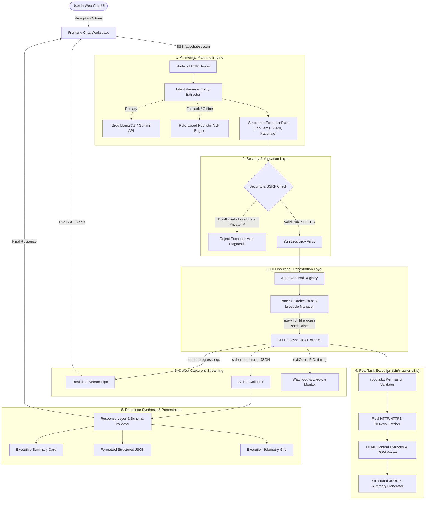

# TaskCLI: CLI-Driven AI Chat Execution for Complex Tasks
### BuildSprint Round 2 • Build & Demonstrate Working Prototype

[](https://nodejs.org/)
[](LICENSE)
[]()
[]()

> A conversational AI application that translates natural-language instructions into controlled, multi-step tasks and executes those tasks by programmatically invoking standalone Command Line Interface (CLI) tools from the backend. The system streams live execution status and stdout/stderr logs, validates structured results, and presents executive summaries and valid JSON to the user.

---

## 1. Challenge & Solution Overview

Standard conversational chatbots typically send user prompts to a language model and merely display generated text. However, real-world tasks require actual execution: web crawling, data extraction, running scripts, and validating outputs.

**TaskCLI** bridges this gap:
1. **Understands Natural Language**: Interprets complex prompts (e.g., *"Crawl https://example.com, extract the important information, give me a summary, and return the extracted data in JSON format"*).
2. **Translates to Controlled CLI Plan**: Selects an approved CLI tool from a whitelist, validates inputs, and constructs secure command-line arguments.
3. **Executes Real CLI Processes**: Spawns an independent child process (`bin/crawler-cli.js`) without raw shell string concatenation (`shell: false`).
4. **Captures Real-time Telemetry**: Streams `stdout` (structured payloads) and `stderr` (operational diagnostics) over Server-Sent Events (SSE) to a live terminal inspector.
5. **Enforces Strict Security Boundaries**: Validates URLs, blocks private/cloud-metadata SSRF attempts, enforces timeout watchdogs, and respects `robots.txt`.
6. **Delivers Dual Presentation**: Presents an executive human-readable summary alongside syntactically valid, downloadable JSON.

---

## 2. System Architecture



---

## 3. The Core Challenge: CLI Execution Implementation

The central challenge requirement is that **the backend must invoke an approved CLI process to perform the actual work**, rather than having an LLM generate text.

### How TaskCLI Solves Each Technical Requirement:

| Requirement | Implementation in TaskCLI | File Reference |
| :--- | :--- | :--- |
| **Tool Selection** | Approved Tool Registry whitelists allowed tools (`site-crawler`). Rejects unapproved binaries. | [`src/orchestrator/toolRegistry.js`](file:///c:/Projects/BuildSprint/src/orchestrator/toolRegistry.js) |
| **Safe Invocation** | Uses `child_process.spawn(executable, args, { shell: false })`. Arguments are passed as an isolated string array, preventing shell command injection. | [`src/orchestrator/cliOrchestrator.js`](file:///c:/Projects/BuildSprint/src/orchestrator/cliOrchestrator.js) |
| **Output Separation** | Progress logs and operational diagnostics stream to `stderr`. Clean, structured data streams to `stdout`. | [`bin/crawler-cli.js`](file:///c:/Projects/BuildSprint/bin/crawler-cli.js) |
| **Real-time Capture** | Live stdout/stderr chunks are captured via stream listeners and pushed over Server-Sent Events (SSE) to the browser UI. | [`src/server.js`](file:///c:/Projects/BuildSprint/src/server.js) |
| **Process Monitoring** | Tracks PID, start time, duration in ms, and exit codes (0 = Success, 1 = Invalid Args, 2 = Network Err, 3 = Timeout, 4 = Blocked). | [`src/orchestrator/cliOrchestrator.js`](file:///c:/Projects/BuildSprint/src/orchestrator/cliOrchestrator.js) |
| **Watchdog & Cancellation** | Enforces maximum execution timeouts. Provides an "Abort" button in UI that sends `SIGTERM` followed by `SIGKILL`. | [`src/orchestrator/cliOrchestrator.js`](file:///c:/Projects/BuildSprint/src/orchestrator/cliOrchestrator.js) |

---

## 4. Security & Responsible Execution Safeguards

TaskCLI implements defense-in-depth protections:

1. **No Raw Shell Concatenation**: Commands are never executed with `child_process.exec()` or `shell: true`. User input cannot escape into arbitrary bash/cmd commands.
2. **Server-Side Request Forgery (SSRF) Defense**:
   - Rejects loopback addresses: `localhost`, `127.0.0.1`, `::1`.
   - Rejects private IPv4 networks (RFC 1918): `10.0.0.0/8`, `172.16.0.0/12`, `192.168.0.0/16`.
   - Rejects cloud metadata endpoints: `169.254.169.254`, `metadata.google.internal`.
   - Rejects non-HTTP protocols (`file://`, `ftp://`, `gopher://`).
3. **Resource Bounds**:
   - Maximum crawl depth limited to `3`.
   - Maximum pages per crawl limited to `10`.
   - Request timeout bounded between `1,000ms` and `60,000ms`.
4. **Policy Respect (`robots.txt`)**: Automatically fetches and respects `robots.txt` directives before crawling paths.
5. **Untrusted Content Sanitization**: All crawled text is stripped of `<script>`, `<style>`, and HTML entities before rendering in the chat interface.

---

## 5. Mandatory Demonstration Use Case

The system comes pre-configured with the mandatory evaluation prompt:

> **"Crawl https://example.com, extract the important information, give me a summary, and return the extracted data in JSON format."**

### Execution Trace:
1. **User Request**: User inputs prompt into chat or clicks the **Mandatory Demo** chip.
2. **Intent Layer**:
   - Target URL: `https://example.com`
   - Intent: `crawl_and_extract`
   - Output Format: `both` (Summary + JSON)
   - Planned Command: `node bin/crawler-cli.js --url "https://example.com" --depth 1 --max-pages 3 --format both`
3. **CLI Invocation**: Backend spawns child process with PID.
4. **Crawl & Extraction**:
   - Checks `https://example.com/robots.txt`.
   - Fetches `https://example.com/` over HTTPS.
   - Extracts title (`Example Domain`), meta tags, headings (`H1: Example Domain`), paragraphs, and links (`https://www.iana.org/domains/example`).
5. **Output**:
   - **Executive Summary Tab**: Formatted markdown card displaying title, word count, reading time, and key takeaways.
   - **Structured JSON Tab**: Syntactically valid JSON adhering to the extraction schema, with **Copy JSON** and **Download JSON** buttons.
   - **Telemetry Tab**: Process PID, exit code `0`, and duration in ms.
   - **Terminal Drawer**: Live timestamped execution logs.

---

## 6. Getting Started & Installation

### Prerequisites
- **Node.js** (v18.0.0 or higher; developed & tested on Node v23.11.0)
- **Zero External npm Dependencies Required!** The application runs out of the box using native Node.js APIs (`http`, `fetch`, `child_process`, `fs`, `url`, `crypto`).

### Quick Setup

1. **Clone the repository**:
   ```bash
   git clone <repository-url>
   cd buildsprint
   ```

2. **Configure Environment (Optional)**:
   Copy `.env.example` to `.env`:
   ```bash
   cp .env.example .env
   ```
   *(If no API keys are provided, TaskCLI automatically uses its built-in heuristic NLP engine with 100% functionality).*

3. **Start the Web Application**:
   ```bash
   npm start
   ```
   Or:
   ```bash
   node src/server.js
   ```

4. **Open in Browser**:
   Open **[http://localhost:3000](http://localhost:3000)** in your web browser.

---

## 7. Running the Standalone CLI Directly

The CLI tool can also be run directly from any terminal or command prompt:

```bash
# View help manual and options
node bin/crawler-cli.js --help

# Run mandatory crawl test
node bin/crawler-cli.js --url https://example.com --format both

# Multi-page crawl with depth 2 and JSON output
node bin/crawler-cli.js --url https://httpbin.org --depth 2 --max-pages 3 --format json

# Verify SSRF protection on CLI
node bin/crawler-cli.js --url http://127.0.0.1:8080
```

---

## 8. Running the Automated Test Suite

A comprehensive test suite verifies tool registration, SSRF defenses, AI intent parsing, HTML extraction, and response formatting:

```bash
# Run all tests and CLI modules
node test/run-all.js
# Or
npm run test:all
```

**Expected output:**
```
=======================================================
 🧪 Starting End-to-End Verification Test Suite
=======================================================

 ✅ PASS: Tool Registry - Validates site-crawler existence
 ✅ PASS: Tool Registry - Rejects unapproved tool
 ✅ PASS: Security - Blocks Localhost SSRF
 ✅ PASS: Security - Blocks 127.0.0.1 Loopback
 ✅ PASS: Security - Blocks AWS/Cloud Metadata IP (169.254.169.254)
 ✅ PASS: Security - Blocks Private RFC1918 IPs (192.168.1.1, 10.0.0.1)
 ✅ PASS: Security - Allows Public HTTPS domain
 ✅ PASS: Security - Enforces Depth and Max Pages Bounds
 ✅ PASS: AI Intent - Interprets Mandatory Demo Prompt
 ✅ PASS: AI Intent - Interprets Multi-page Depth Prompt
 ✅ PASS: AI Intent - Handles Prompt Missing URL Gracefully
 ✅ PASS: HTML Parser - Extracts metadata, headings, paragraphs, and links
 ✅ PASS: Response Layer - Generates valid markdown and JSON structure

=======================================================
 🏁 Test Results: 13/13 Passed (100%)
=======================================================
```

---

## 9. Technology Stack & AI Disclosure

- **Backend Runtime**: Node.js v23 (Native `http`, `fetch`, `child_process.spawn`)
- **Frontend**: Modern Vanilla JS (ES6+), Server-Sent Events (SSE), Responsive CSS Glassmorphism
- **CLI Engine**: Node.js standalone CLI utility (`bin/crawler-cli.js`)
- **AI Intent Parsing**:
  - Primary: Groq API (`llama-3.3-70b-versatile`) / Gemini API
  - Fallback / Offline: High-precision regex & heuristic entity extraction engine
- **AI Assistance Disclosure**: Built with assistance from Google DeepMind's Antigravity agentic environment for rapid prototyping, architecture design, and comprehensive test suite development.

---

## 10. Project Directory Layout

```
buildsprint/
├── .env.example              # Environment variables template
├── .gitignore                # Git ignore rules (secrets protected)
├── package.json              # Project scripts and metadata
├── README.md                 # Complete documentation & architecture guide
├── DEMO_WALKTHROUGH.md       # Minute-by-minute video recording script
├── bin/
│   └── crawler-cli.js        # Standalone CLI tool executable from terminal
├── src/
│   ├── ai/
│   │   ├── intentParser.js   # Dual LLM + heuristic intent planning engine
│   │   └── summarizer.js     # Executive summary & JSON response layer
│   ├── crawler/
│   │   ├── engine.js         # Core BFS crawl & HTTP execution engine
│   │   ├── htmlParser.js     # HTML metadata, headings, links, and text parser
│   │   └── robots.js         # robots.txt validator
│   ├── orchestrator/
│   │   ├── cliOrchestrator.js# Process spawner, stdout/stderr stream pipe, timeout manager
│   │   ├── toolRegistry.js   # Approved CLI tools whitelist & argument builder
│   │   └── security.js       # SSRF protection and input validation
│   ├── public/
│   │   ├── index.html        # Modern chat interface
│   │   ├── style.css         # Dark-mode terminal theme & responsive styling
│   │   └── app.js            # SSE streaming client, live terminal drawer, JSON viewer
│   └── server.js             # HTTP & SSE backend server
└── test/
    ├── test-orchestrator.js  # Orchestrator & security tests
    └── test-e2e.js           # 13-stage end-to-end test suite
```

---

## 11. Video Demonstration Guide

See [`DEMO_WALKTHROUGH.md`](file:///c:/Projects/BuildSprint/DEMO_WALKTHROUGH.md) for the complete 4–7 minute video recording walkthrough, script talking points, and live demonstration checklist.
"# CLI_Driven-AI-Task-Orchestractor" 
